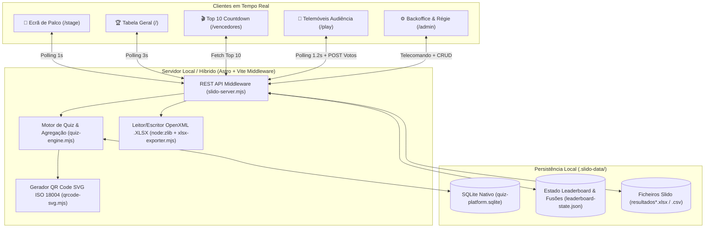

# 🛠️ Arquitetura Técnica, Base de Dados & Desenvolvimento

Este documento descreve a arquitetura técnica da **Plataforma Interativa de Quizzes, Sondagens & Classificação FNAC**, as decisões de engenharia, o modelo de dados SQLite, os motores nativos (Excel `.xlsx` e QR Code SVG) e a referência completa da API REST.

---

## 1. Visão Geral da Arquitetura

A aplicação foi desenhada com uma filosofia **Zero-Dependências Nativas Externas** para garantir máxima fiabilidade em ambiente de evento presencial (sem depender de serviços cloud terceiros ou bibliotecas C++ que possam falhar em atualizações do macOS).



---

## 2. Estrutura de Ficheiros do Projeto

```text
slidofnac/
├── .agents/
│   └── rules/
│       └── mandatory-questions-and-suggestions.md  # Regra obrigatória de alinhamento e inovação
├── .slido-data/                                    # Dados persistentes (ignorados pelo Git)
│   ├── quiz-platform.sqlite                        # Base de dados SQLite das sessões ao vivo
│   └── leaderboard-state.json                      # Rondas importadas e unificações manuais de nomes
├── docs/                                           # Manuais e documentação técnica (.md)
│   ├── ARQUITETURA_E_DESENVOLVIMENTO.md
│   ├── GUIA_8_MODELOS_INTERATIVOS.md
│   ├── MANUAL_OPERADOR_E_REGIE.md
│   └── RUNBOOK_EVENTOS_FNAC.md
├── public/
│   └── resultados.csv                              # Ficheiro CSV base de fallback
├── src/
│   ├── lib/
│   │   ├── qrcode-svg.mjs                          # Codificador QR Code ISO/IEC 18004 puro JS -> SVG
│   │   ├── quiz-engine.mjs                         # Motor SQLite, 8 modelos Slido e Ranking de Lojas
│   │   ├── slido-server.mjs                        # Plugin Vite API, parser XLSX/CSV e unificação de nomes
│   │   └── xlsx-exporter.mjs                       # Construtor ZIP/OpenXML multi-folha (.xlsx)
│   └── pages/
│       ├── index.astro                             # Vista de Palco: Tabela de Classificação Geral
│       ├── stage.astro                             # Vista de Palco: Lobby QR + 8 Modelos + Ranking Lojas
│       ├── play.astro                              # Web App Mobile para os Participantes
│       ├── vencedores.astro                        # Revelação Top 10 em Countdown (#10 -> #1)
│       └── admin.astro                             # Backoffice, Telecomando, Criador 8 Modelos e Manuais
├── astro.config.mjs                                # Configuração Astro + registo do middleware API
├── package.json                                    # Scripts e dependências (Astro + Tailwind CSS)
├── tailwind.config.mjs                             # Configuração Tailwind CSS
└── README.md                                       # Documento principal de entrada
```

---

## 3. Esquema da Base de Dados SQLite (`quiz-platform.sqlite`)

Gerida pelo módulo nativo `node:sqlite` (`DatabaseSync`) em [`src/lib/quiz-engine.mjs`](file:///Users/daviscorreia/Antigravity%20/slidofnac/src/lib/quiz-engine.mjs) com modo `WAL` (*Write-Ahead Logging*) ativado para leituras e escritas concorrentes de centenas de telemóveis:

### Tabelas Principais

1. **`quizzes`** *(Sessões / Playlists)*
   - `id` (`TEXT PRIMARY KEY`): Identificador único da sessão.
   - `code` (`TEXT`): Código curto de acesso (ex.: `FNAC26`).
   - `title` (`TEXT`): Título da convenção ou ronda.
   - `description` (`TEXT`): Subtítulo apresentado no Lobby.
   - `created_at` (`TEXT`): Data/hora ISO de criação.

2. **`questions`** *(Atividades dos 8 Modelos)*
   - `id` (`TEXT PRIMARY KEY`): Identificador da atividade.
   - `quiz_id` (`TEXT`): Referência à sessão (`quizzes.id`).
   - `order_index` (`INTEGER`): Ordem da atividade na playlist.
   - `text` (`TEXT`): Enunciado da pergunta ou tema.
   - `type` (`TEXT`): Um dos 8 modelos (`quiz`, `poll`, `wordcloud`, `opentext`, `ideas`, `ranking`, `rating`, `survey`).
   - `options_json` (`TEXT`): Array JSON de opções (para `quiz`, `poll`, `ranking`).
   - `correct_index` (`INTEGER`): Índice da resposta certa (apenas para `quiz`).
   - `time_limit_sec` (`INTEGER`): Tempo limite em segundos.
   - `points_multiplier` (`INTEGER`): `1` (normal) ou `2` (*Pontos Duplos*).
   - `image_url` (`TEXT`): URL opcional de imagem para a pergunta.
   - `image_reveal_mode` (`TEXT`): `'none' | 'blur' | 'zoom'`.
   - `config_json` (`TEXT`): Configuração adicional JSON (`maxStars` para `rating`, array `questions` para `survey`).

3. **`participants`** *(Colaboradores em Sala)*
   - `id` (`TEXT PRIMARY KEY`): Token único guardado no `localStorage` do telemóvel.
   - `name` (`TEXT`): Nome de exibição.
   - `normalized_key` (`TEXT`): Chave normalizada (sem acentos, minúsculas) para cruzamento automático com o Leaderboard.
   - `employee_id` (`TEXT`): Número de colaborador opcional.
   - `team_name` (`TEXT`): Loja ou Direção FNAC selecionada (para a *Batalha de Lojas*).

4. **`answers`** *(Respostas e Submissões)*
   - `id` (`TEXT PRIMARY KEY`)
   - `quiz_id`, `question_id`, `participant_id`
   - `selected_index` (`INTEGER`): Índice escolhido (`quiz`/`poll`) ou número de estrelas (`rating`).
   - `is_correct` (`INTEGER`): `1` se acertou, `0` caso contrário.
   - `points_awarded` (`INTEGER`): Pontos atribuídos (`0`, `1` ou `2`).
   - `time_ms` (`INTEGER`): Tempo de reação em milissegundos (calculado com proteção anti-batota entre cliente e servidor).
   - `response_text` (`TEXT`): Texto submetido (`wordcloud`, `opentext`, `ideas`).
   - `response_json` (`TEXT`): Array de ordenação (`ranking`) ou objeto de respostas (`survey`).

5. **`idea_votes`** *(Upvotes em Tempo Real para o Modelo Ideas)*
   - `answer_id` (`TEXT`), `participant_id` (`TEXT`), `created_at` (`TEXT`)
   - `PRIMARY KEY (answer_id, participant_id)` para garantir 1 voto único por participante em cada ideia.

6. **`roster`** *(Lista de Autocomplete de Colaboradores)*
   - `normalized_key` (`TEXT PRIMARY KEY`), `name`, `employee_id`, `team_name`.

7. **`live_state`** *(Estado Sincronizado do Palco)*
   - Linha única (`id = 1`) com `active_quiz_id`, `status` (`lobby`, `question_open`, `question_reveal`, `leaderboard`), `current_question_index`, `question_started_at`, `public_base_url`, `include_imported_rounds` e `leaderboard_mode` (`individual` | `teams`).

---

## 4. Algoritmo de Unificação de Utilizadores e Pontuação

Implementado em [`src/lib/slido-server.mjs`](file:///Users/daviscorreia/Antigravity%20/slidofnac/src/lib/slido-server.mjs):

1. **Normalização Automática (`normalizeNameKey`)**:
   - Remove acentos/diacríticos via decomposição Unicode `NFD`.
   - Converte `_`, `-` e `.` em espaços e colapsa espaços múltiplos.
   - Converte para minúsculas. Assim, `"João_Silva"`, `"joao silva"` e `"JOÃO SILVA "` são automaticamente reconhecidos como o mesmo participante.
2. **Soma Inteligente dentro de cada `Quiz ID`**:
   - Se o mesmo participante tiver múltiplas entradas no mesmo `Quiz ID` (ex.: reconexão a meio do quiz), os seus pontos (`Quiz score`) e tempos (` Quiz time (ms)`) são **somados**, enquanto o total de perguntas da ronda (`Max score`, ex.: `12`) se mantém fixo para aquela ronda (evitando duplicar o denominador para `12/24`).
   - Entre rondas com `Quiz ID` diferentes, somam-se tanto os pontos obtidos como o `Max score` de cada ronda distinta.
3. **Deteção de Nomes Parecidos (Levenshtein + Tokens)**:
   - O motor compara todos os participantes entre si calculando a distância de edição de Levenshtein e prefixos comuns (ex.: `"Miguel Vilaça"` vs `"Miguel Vilaca"` ou primeiro + último nome) e apresenta sugestões de unificação com 1 clique no `/admin`.
4. **Unificação Manual Persistente**:
   - O operador pode selecionar 2 ou mais participantes na tabela do `/admin`, escolher o nome final pretendido e clicar em **🔗 Unificar**. As regras ficam gravadas em `.slido-data/leaderboard-state.json` e podem ser revertidas a qualquer momento.

---

## 5. Referência da API REST

Todos os endpoints são servidos pelo middleware em [`src/lib/slido-server.mjs`](file:///Users/daviscorreia/Antigravity%20/slidofnac/src/lib/slido-server.mjs):

| Método | Endpoint | Descrição |
| :--- | :--- | :--- |
| `GET` | `/api/leaderboard` | Devolve a classificação geral (`standings`), classificação por lojas (`teamStandings`), sugestões de fusão e metadados. |
| `POST` | `/api/upload` | Recebe um ficheiro `.xlsx` ou `.csv` em Base64 e integra-o em modo `merge` (somar/atualizar ronda) ou `replace` (substituir tudo). |
| `POST` | `/api/settings` | Atualiza `topLimit` (Top 5/10/15/20) ou executa `mergeUsers` / `unmergeUsers`. |
| `GET` | `/api/live/state` | Estado completo em tempo real do palco, pergunta ativa, estatísticas agregadas dos 8 modelos e classificação. |
| `GET` | `/api/live/roster?q=` | Pesquisa rápida de nomes de colaboradores para autocomplete no telemóvel. |
| `POST` | `/api/live/join` | Regista ou atualiza um participante com nome e Loja/Equipa FNAC (`teamName`). |
| `POST` | `/api/live/answer` | Submete resposta a qualquer um dos 8 modelos ou faz *upvote* (`action: 'upvote_idea'`) numa ideia. |
| `POST` | `/api/live/control` | Executa comandos do Host (`set_status`, `open_question`, `reveal_answer`, `next_question`, `save_question`, `create_quiz`, etc.). |
| `GET` | `/api/live/export.xlsx` | Gera e descarrega um ficheiro Excel `.xlsx` com 4 folhas completas de resultados. |

---

## 6. Registo Histórico de Desenvolvimento (Changelog)

- **Fase 1 — Infraestrutura macOS & Leitor Nativo `.XLSX`**:
  - Criação da estrutura Astro + Tailwind CSS e parser nativo de ficheiros Excel OpenXML (`resultados.csv.xlsx`) usando `node:zlib` sem dependências externas.
- **Fase 2 — Normalização Automática & Unificação Manual de Utilizadores**:
  - Implementação da soma automática de repetições por `Quiz ID`, algoritmo de sugestões de nomes parecidos e painel de unificação manual no `/admin`.
- **Fase 3 — Ecrã de Revelação Dramática Top 10 (`/vencedores`)**:
  - Criação da página de apresentação de vencedores em contagem decrescente (`#10` a `#1`), controlada por clique/teclado, com lançamento de confetti no 1.º lugar.
- **Fase 4 — Paleta Oficial Slido & Rácio Questões Certas (`12/12`)**:
  - Aplicação do gradiente vermelho/laranja/amarelo (`#C81908` → `#EB7802` → `#F8C600`), cartão `#FAF8F5`, barra de liderança `#FFCC00` e apresentação de `certas/total` (`12/12`) + tempo `M:SS`.
- **Fase 5 — Motor de Quizzes Ao Vivo com QR Code (`/stage` e `/play`)**:
  - Base de dados SQLite nativa (`node:sqlite`), gerador QR Code SVG (`qrcode-svg.mjs`) e sincronização em tempo real entre Palco, Telemóveis e Backoffice.
- **Fase 6 — Suite Completa dos 8 Modelos Slido & Funcionalidades FNAC**:
  - Expansão para os 8 modelos (*Multiple choice*, *Word cloud*, *Open text*, *Ideas*, *Ranking*, *Rating*, *Quiz*, *Survey*), *Batalha de Lojas FNAC*, *Pontos Duplos 2x*, *Imagem Misteriosa (Blur/Zoom)* e *Exportação Excel Multi-Folha (`.xlsx`)*.

